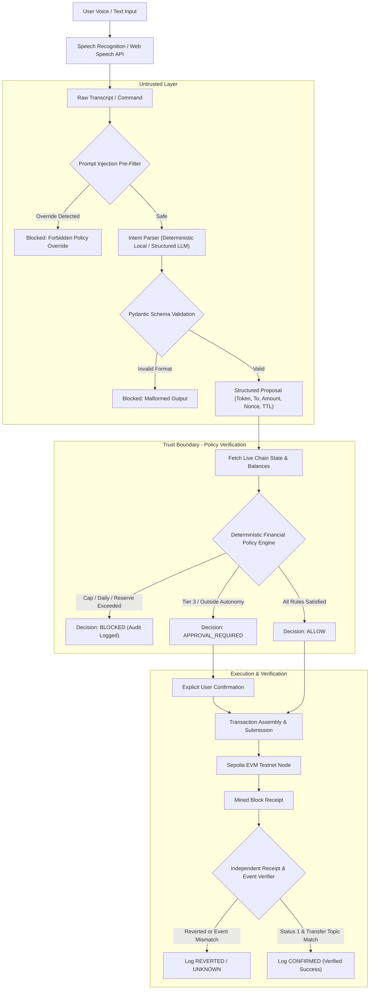

# Guardian Wallet — System Architecture & Trust Boundaries

## 1. System Overview

Guardian Wallet is an autonomous AI-assisted blockchain wallet designed for the 2026 Shenzhen International FinTech Competition (FinTechathon), Topic F.

The fundamental design tenet is:
> An AI agent can act within explicitly granted financial permissions, but cannot grant itself additional authority or bypass the wallet's security controls.

The architecture enforces a strict separation between untrusted natural language interpretation and deterministic financial authorization. The language model possesses zero signing keys and zero authority to alter wallet security policies.

---

## 2. End-to-End Transaction Pipeline



---

## 3. Trust Boundaries & Enforcement Matrix

| Component | Trust Level | Access to Keys | Enforcement Responsibility |
| :--- | :--- | :--- | :--- |
| Voice / Speech API | Untrusted | None | Audio capture; requires user visual confirmation before dispatch |
| AI LLM / NLP | Untrusted | None | Converts human language into candidate typed parameter objects |
| Prompt Injection Filter| Trusted | None | Blocks adversarial instructions before any parameter generation |
| Policy Engine | Highly Trusted | None | Mathematical checks on caps, daily spending, reserve floors, allowlists |
| Transaction Service | Highly Trusted | Transaction Signer | State machine orchestration, nonce serialization, replay prevention |
| Receipt Verifier | Highly Trusted | None | Verifies event topics, logs, gas consumption, and execution status |
| Smart Policy Guard | Root of Trust | On-Chain Guard | On-chain enforcement of caps, daily allowance, and emergency pauses |

---

## 4. Detailed Component Walkthrough

### 4.1 Speech-to-Text Layer
Voice commands are captured via the standard Web Speech API in web browsers or the native speech engine on Android. Audio data is transcribed in real-time and displayed in an editable text field. Speech recognition output is untrusted input and never directly executes a financial transfer.

### 4.2 Adversarial Input Pre-Filter & Intent Parser
Before any model inference, inputs are scanned for prompt-injection markers (`"ignore previous instructions"`, `"override policies"`, `"bypass limits"`). Valid inputs are parsed into a strict schema:
- `intent_type`: `transfer`, `read_balance`, `query_spending_allowance`, `query_history`, `estimate_fee`, `emergency_pause`, `unsupported`
- `token_address`: Verified contract address (resolved from local configuration, never hallucinated)
- `recipient_address`: 42-character hex address (resolved only from approved local address book)
- `amount`: Exact positive decimal string (no binary float representation)

### 4.3 Deterministic Policy Engine
The policy engine evaluates 16 independent parameters:
1. Supported Chain ID (`11155111`)
2. Allowed Token Address
3. Supported Action Type (`erc20_transfer`)
4. Recipient Allowlist Verification
5. Single-Transaction Ceiling
6. Daily Spending Allowance
7. Protected Reserve Floor
8. Gas Price Ceiling
9. Agent Permission Tier (Tier 1 Observe, Tier 2 Limited Autonomy, Tier 3 Human Approval)
10. Emergency Pause State
11. Authorization TTL (5-minute expiration)
12. Authorization Nonce & Replay Protection
13. Policy Version Consistency
14. Calldata & Approval Restrictions
15. Concurrency Serialization
16. Chain State Freshness

### 4.4 Transaction State Machine
```
DRAFT -> VALIDATING -> POLICY_CHECK -> [READY | BLOCKED] -> SUBMITTED -> PENDING -> [CONFIRMED | REVERTED | UNKNOWN]
```
Even if a transaction is blocked by policy and never submitted to the blockchain, a rejection record is created and permanently stored in the application audit log.

### 4.5 Independent Receipt & Transfer Event Verifier
A successful JSON-RPC transaction receipt (`status == 1`) is necessary but not sufficient. The verifier inspects the transaction log topics to confirm:
- Event signature: `Transfer(address,address,uint256)` (`0xddf252ad1be2c89b69c2b068fc378daa952ba7f163c4a11628f55a4df523b3ef`)
- Event contract address matches the intended token contract
- Event recipient topic matches the intended proposal recipient
- Event data matches the exact transfer amount in base token units

---

## 5. Security Invariants
- Invariant 1: No payment can execute if `balance - amount < min_reserve`.
- Invariant 2: No payment can execute if `spent_today + amount > daily_spending_limit`.
- Invariant 3: No authorization can be reused (strictly monotonic nonce and unique proposal ID).
- Invariant 4: Changing any policy field immediately increments `policy_version`, invalidating all unexecuted authorizations.
